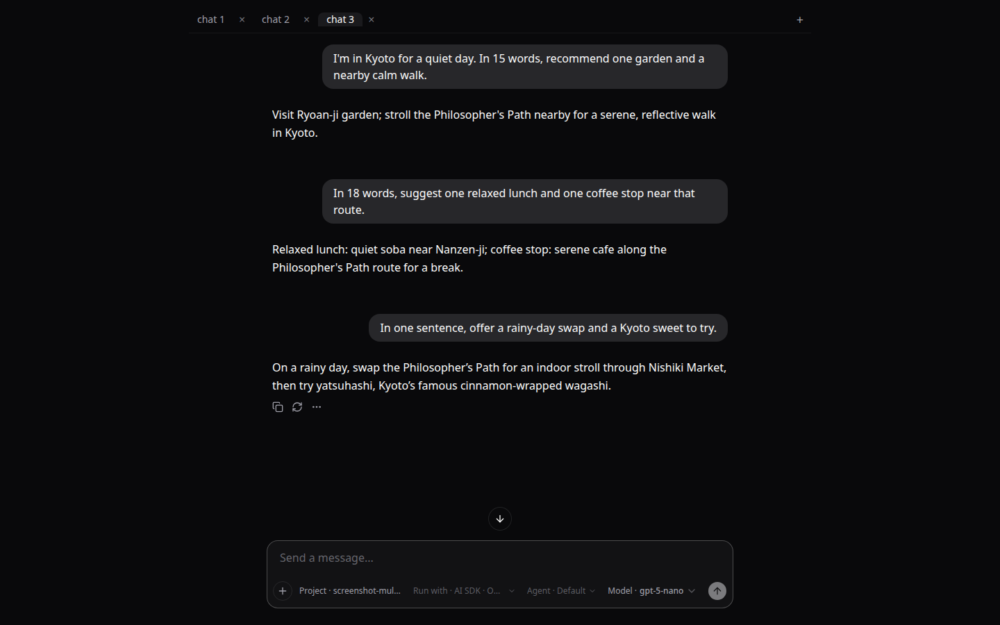

# agentilogue

**A minimal chat UI for AI models today, with opt-in local agent runtimes.**



agentilogue is an open-source chat app built with [Next.js](https://nextjs.org/) and [assistant-ui](https://github.com/assistant-ui/assistant-ui). It keeps the conversation experience focused while allowing different backends.

> **Status:** Early development. AI SDK + OpenAI and opencode ACP are supported. opencode · Native is **Supported for trusted-local use (opt-in)**: one trusted user on one machine, with both app and opencode server bound to loopback and HTTP Basic authentication required on the opencode server. Remote or multi-user hosting is unsupported. The upstream adapter API remains experimental. See [native known issues and recovery](/docs/opencode-native-known-issues.md).

## What it does

- Streams model responses through the Vercel AI SDK and OpenAI.
- Offers opt-in local agent sessions through opencode ACP.
- Supports opt-in native opencode conversations for one trusted local user.
- Keeps chat UI separate from backend execution, with session tabs and provider-specific controls.

The primary model-chat path is:

```text
assistant-ui → useChatRuntime → /api/chat → Vercel AI SDK → OpenAI
```

AI SDK transcripts are in-memory and are not persisted. Native opencode session mappings live in the current browser tab's `sessionStorage`; the opencode password stays in memory and must be entered again after reload. Chat tabs are not project-isolation or sandbox boundaries.

## Quick start

Requirements: [Bun](https://bun.sh/) and an [OpenAI API key](https://platform.openai.com/api-keys) for the AI SDK path.

```bash
git clone https://github.com/tbrandenburg/agentilogue.git
cd agentilogue
bun install
```

Create `.env.local` in the project root:

```env
OPENAI_API_KEY=your-api-key
```

Start the app and open [http://localhost:3000](http://localhost:3000):

```bash
bun run dev
```

## Optional local opencode integrations

### ACP

Install and authenticate the opencode CLI separately, then add to `.env.local`:

```env
AGENT_API_ENABLED=1
AGENT_TRUSTED_LOCAL=1
OPENCODE_CWD=/absolute/path/to/project
# Optional; defaults to `opencode` on PATH.
# OPENCODE_EXECUTABLE=/absolute/path/to/opencode
```

Restart with `bun run dev`. This API has no caller authentication and must remain bound to loopback on a trusted machine. Do not expose it through a reverse proxy or shared/untrusted network. opencode's tools are not sandboxed by agentilogue. See [API limits and behavior](docs/opencode-agent-api.md).

### Native — Supported for trusted-local use (opt-in)

Use one trusted user's own projects/sessions on one machine, with both app and server bound to loopback, HTTP Basic auth enabled on the opencode server, and the exact configured app origin. The app itself does not implement caller authentication. This is not remote/multi-user support, per-project authorization, or a filesystem sandbox. Tools retain the local user's native opencode permissions and authority.

Use the tested opencode `1.18.35` server generation, not an incompatible global CLI. Start the server from the intended project directory:

```bash
OPENCODE_SERVER_PASSWORD='choose-a-local-password' bunx --package opencode-ai@1.18.35 opencode serve --hostname 127.0.0.1 --cors http://localhost:3000
```

Configure the app server in `.env.local` (do not put the opencode password here), then restart:

```env
OPENCODE_NATIVE_ENABLED=1
OPENCODE_NATIVE_URL=http://127.0.0.1:4096
OPENCODE_NATIVE_APP_ORIGIN=http://localhost:3000
```

Enter the server password in the selected chat when prompted. It is held in that chat's memory only; never put it in app configuration or browser storage. Missing/wrong passwords, invalid server URLs, and app-origin mismatches remain blocked. Loopback/CORS alone are not authentication.

After a server outage, reload the page and re-enter the password to restore the tab-local session mapping/history. Inspect partial work before manually retrying: **Outcome unknown** is not completion, and retrying can repeat side effects. No prompt is automatically resent. Seamless reconnect is not guaranteed, even after a short outage. Native model/agent choices lock after the first message; start a new session to change them.

Read [native known issues, support limits, and recovery](/docs/opencode-native-known-issues.md) before enabling. The pinned `@assistant-ui/react-opencode@0.2.30` API remains **experimental upstream**; retest adapter/SDK/server upgrades, including stream readiness and cancellation. To disable native, unset `OPENCODE_NATIVE_ENABLED` or set it to `0`, then restart the app. Support does not mean default-enabled.

## Documentation

- [Architecture](docs/ARCHITECTURE.md) — integration lanes and boundaries.
- [Agent contracts](docs/CONTRACTS.md) — provider-neutral backend contract.
- [opencode ACP API](docs/opencode-agent-api.md) — security and API behavior.
- [Development guidance](AGENTS.md) — project principles and workflows.

## Contributing

Before larger changes, read [AGENTS.md](AGENTS.md) and [the architecture guide](docs/ARCHITECTURE.md). Run the project checks with:

```bash
bun install --frozen-lockfile
make format
make lint
make test
make build
```

The independent CI `Build` check runs the production Next.js build, including generated route/module validation. Reproduce failures with `bun install --frozen-lockfile` and `make build` in a clean checkout; no API keys or agent servers are needed (Google Fonts downloads require network access). Maintainers must make `Build` a required status check for `main` in GitHub rulesets or branch protection; the workflow alone does not enforce merge blocking.

The project is early-stage; contributions and feedback are welcome. See [GitHub issues](https://github.com/tbrandenburg/agentilogue/issues).
