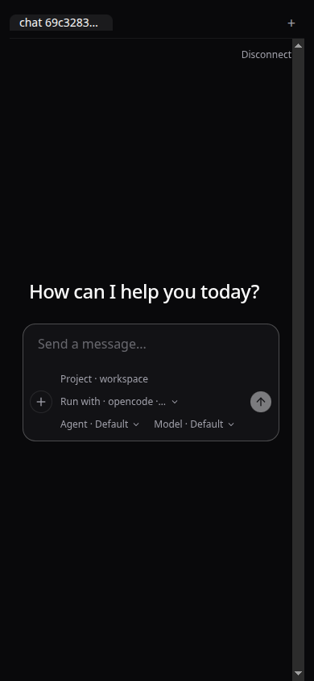
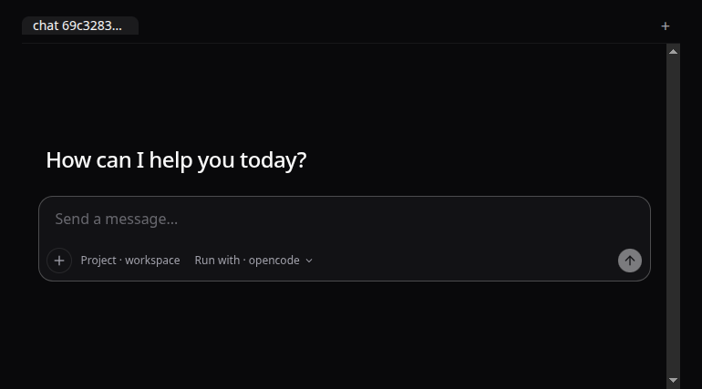
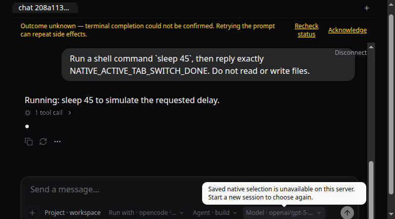

# Issue #43: provider-controls follow-up evidence

## Decision and scope

The provider-controls refactor is separated from PR #49 into its own follow-up branch. The shared composer rail now owns only Project and Run with. AI SDK model/agent controls and native opencode agent/model controls are separate provider-local children mounted below their matching `AssistantRuntimeProvider`.

ACP intentionally renders Project and Run with only. The ACP provider advertises neither model nor agent selection; its former disabled Agent/Model placeholders did not correspond to supported provider actions. A real ACP run verified that the reduced rail remains usable.

## Automated controls tests

`tests/session-controls-render.test.tsx` renders controls inside assistant-ui's public `AssistantRuntimeProvider` and `useExternalStoreRuntime` APIs. It covers:

- provider-specific controls require a runtime provider;
- AI SDK controls render in the AI SDK slot;
- ACP omits unsupported Agent/Model controls;
- native catalog options and saved selection values render;
- loading/unavailable catalog states disable native choices;
- first-message and restored-session state lock native choices.

## Production browser E2E

Tested on Next.js `16.3.8`, `@assistant-ui/react@0.15.25`, `@assistant-ui/react-opencode@0.2.30`, `@opencode-ai/sdk@1.18.35`, and opencode CLI/server `1.18.35`. The app and server used loopback ports `39002` and `39001`, a disposable workspace under `/tmp`, isolated HOME/XDG data, and an ephemeral synthetic Basic-auth password. The existing provider key was inherited by the isolated OpenCode process but was never read, printed, or stored in this report.

| Lane            | Test                                                                                                                                                                            | Result |
| --------------- | ------------------------------------------------------------------------------------------------------------------------------------------------------------------------------- | ------ |
| AI SDK          | Select `gpt-5-nano`, send the welcome suggestion, receive a response from `/api/chat`.                                                                                          | PASS   |
| Native opencode | Connect: unauthenticated health returned 401, authenticated health returned 200; provider/agent/session catalog endpoints returned 200.                                         | PASS   |
| Native opencode | Select `build` and `openai/gpt-5-nano`, send a harmless prompt, receive exactly `NATIVE_E2E_OK`.                                                                                | PASS   |
| Native opencode | After the first user message, Run with, Agent, and Model controls are disabled.                                                                                                 | PASS   |
| Native opencode | Reload, re-enter the password, recover the same transcript, and retain disabled controls for the restored native session.                                                       | PASS   |
| ACP             | Select `opencode`; Agent/Model placeholders are absent. Send a harmless prompt and receive exactly `ACP_E2E_OK`.                                                                | PASS   |
| Tabs            | Native A and ACP B retain their own selection/transcript when switching after the runs settle.                                                                                  | PASS   |
| Tabs            | Run native `sleep 45`, switch to ACP, confirm A's close control remains disabled, return to A, and observe Stop plus its single running tool call.                              | PASS   |
| Native opencode | At 390×844, document and body widths remain 390px; no horizontal overflow.                                                                                                      | PASS   |
| Native opencode | Stop the server during the active native run; the UI shows connection recovery guidance and unknown outcome. Restart and reauthenticate; restore the transcript without replay. | PASS   |
| Native opencode | Restrict the restarted server to `enabled_providers: ["opencode"]`, excluding the saved OpenAI model. The UI reports the selection unavailable and keeps sending disabled.      | PASS   |

The app's server-origin health probe intentionally makes an unauthenticated request before the authenticated request; its 401 console entry is expected. No provider password or API key is included in screenshots or logs.

## Validation

- `bun run format` — passed.
- `bun run lint` — passed.
- `bun test` — 125 passed, 0 failed across 22 files after merging PR #49.
- `bun run typecheck` — passed.
- `bun run build` — passed after the render-test file was added.

Render tests cover loading/unavailable catalog props. The real server outage and stale-model catalog restriction also passed as recorded above. Issue #43 remains open until PR #50's final review and merge.
